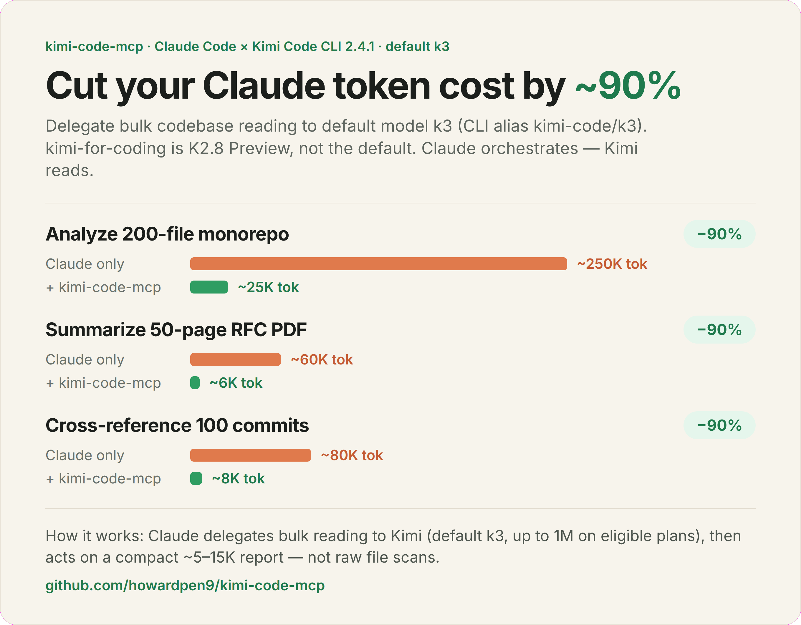
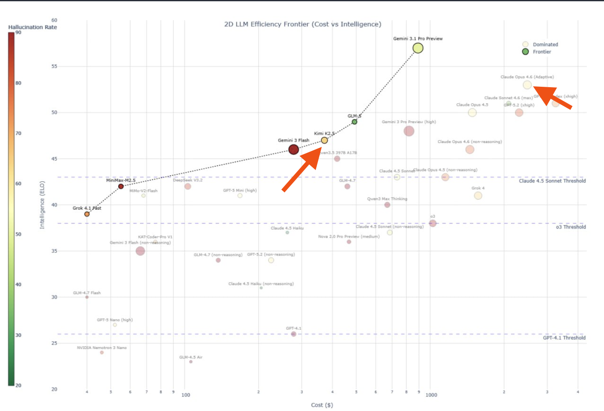

# kimi-code-mcp

English | **[中文說明](README_zh.md)**

---

<div align="center">
  
  <br />
  <sub>Illustrative estimates. The ~90% is <b>Claude-side</b> token reduction on analysis-heavy tasks — <b>not</b> total cost: Kimi's own <a href="https://www.kimi.com/code/en">subscription</a> still applies. The monorepo row mirrors the example below; the PDF/commits rows are rough sketches. The graphic still says <code>kimi-for-coding</code> (K2.7, 256K). This server's default is model id <code>k3</code> (CLI alias <code>kimi-code/k3</code>).</sub>
</div>

---

**Delegate codebase analysis from Claude to Kimi Code (default model `k3`, CLI alias `kimi-code/k3`) — cut Claude-side token cost ~90%.**

| Task                         | Claude only | Claude + kimi-code-mcp | Claude-side savings |
|------------------------------|-------------|------------------------|---------------------|
| Analyze 200-file monorepo    | ~250K tok   | ~25K tok               | ~90%                |
| Summarize 50-page RFC PDF    | ~60K tok    | ~6K tok                | ~90% *(sketch)*     |
| Cross-reference 100 commits  | ~80K tok    | ~8K tok                | ~90% *(sketch)*     |

<sub>*Illustrative estimates — savings are on Claude tokens only and depend on the task; Kimi's subscription cost is separate. See [Token Economics](#token-economics).</sub>

## Quick start

```bash
# 1. Install the current Kimi Code CLI (macOS / Linux) and log in.
#    code.kimi.com/install.sh redirects to the archived Python kimi-cli. Do not use it.
curl -fsSL https://code.kimi.com/kimi-code/install.sh | bash
kimi login

# Node.js >= 22.19.0 alternative:
# npm install -g @moonshot-ai/kimi-code

# This server runs ~/.local/bin/kimi only. The installer puts the binary in
# ~/.kimi-code/bin and adds that directory to your shell rc.
mkdir -p "$HOME/.local/bin"
ln -sfn "$HOME/.kimi-code/bin/kimi" "$HOME/.local/bin/kimi"

# 2. Install this MCP server (Node.js >= 18)
npm install -g kimi-mcp-server
```

> [!WARNING]
> On 2026-11-02 the npm registry only has `kimi-mcp-server@0.3.0`. Git `main` is 0.5.0 and is not published, so `npm install -g` does not yet default to `k3` or read `~/.kimi-code/config.toml`. Use [Install from source](#install-from-source) until 0.5.0 is published if you need the behavior on this page.

Windows (PowerShell): `irm https://code.kimi.com/kimi-code/install.ps1 | iex`. The runner in this repo still expects the POSIX path `~/.local/bin/kimi`, so link the installed `kimi` binary there the same way.

Project scope — commit `.mcp.json` at the repo root:

```json
{
  "mcpServers": {
    "kimi-code": {
      "command": "npx",
      "args": ["-y", "kimi-mcp-server"]
    }
  }
}
```

User scope (all projects, stored in `~/.claude.json`, not `~/.claude/mcp.json`):

```bash
claude mcp add --scope user --transport stdio kimi-code -- npx -y kimi-mcp-server
```

Run `/mcp` in Claude Code to verify — you should see `kimi-code` with 8 tools.

The MCP defaults to `k3` and passes `-m kimi-code/k3` on CLI calls.
Override with the tool's `model` argument or `KIMICODE_MODEL` / `KIMI_MODEL`
(argument wins). On CLI 2.4.1, `kimi provider list` prints `Default model: …` when a default is set.
That value can differ from the MCP default. Switch inside the CLI with `/model`.

> [!TIP]
> **You don't need the CLI for the common case.** `kimi_query` and `kimi_verify` call the Kimi Code API directly — no CLI install or `kimi login` required. Set `$KIMICODE_API_KEY` (see [Kimi Code API Setup](#kimi-code-api-setup)). Only `kimi_analyze` and `kimi_resume` spawn the CLI. See [Two backends: API vs CLI](#two-backends-api-vs-cli).

## How it works

1. **Claude calls the `kimi_analyze` tool** when a task needs bulk codebase reading.
2. **MCP routes the request to Kimi Code** (default `-m kimi-code/k3`) — Kimi reads the codebase from disk.
3. **The result is piped back as a structured response** — Claude acts on it with precise, targeted edits.

```
┌──────────────┐  stdio/MCP   ┌──────────────┐  subprocess   ┌──────────────┐
│  Claude Code │ ◄──────────► │ kimi-code-mcp│ ────────────► │ Kimi CLI     │
│  (conductor) │              │ (MCP server) │               │ (k3)         │
└──────────────┘              └──────────────┘               └──────────────┘
```

## Two backends: API vs CLI

The server reaches Kimi two different ways, and **each tool uses the one that fits its job**. Knowing which is which tells you what you need to set up.

| Backend | How it talks to Kimi | What it needs | Sees your codebase? |
|---------|----------------------|---------------|---------------------|
| **Direct API** | HTTPS to `api.kimi.com/coding/v1` (or `KIMI_BASE_URL`) | An API key (`$KIMICODE_API_KEY`, or `api_key` in `~/.kimi/config.toml` / `~/.kimi-code/config.toml`) | ❌ No — you paste in the context |
| **Local CLI** | Spawns the `kimi` binary as a subprocess | CLI installed **and** `kimi login` done | ✅ Yes — reads files from disk |

| Tool | Backend | Why |
|------|---------|-----|
| `kimi_query` | **API** (CLI only if no key configured) | Contextless Q&A — no codebase needed, so the API is simpler and has no login dependency |
| `kimi_verify` | **API** | You pass the code/diff/claim inline; Kimi judges it as an independent third party |
| `kimi_analyze` | **CLI** | Reads the codebase from disk. Context follows the model window |
| `kimi_resume` | **CLI** | Continues a stateful CLI session that holds prior codebase context |
| `kimi_list_sessions`, `kimi_cache_*`, `kimi_status` | local | Read local session/cache metadata |

> [!IMPORTANT]
> **Most users only need the API key.** If you just want a second opinion / verification (`kimi_query`, `kimi_verify`), set the API key and you're done — skip the CLI entirely. Install + `kimi login` only when you want Kimi to read your codebase via `kimi_analyze` / `kimi_resume`.

Run **`kimi_status`** any time to see which backends are live — it reports the API-configured state and the CLI install/auth state separately.

## Guidelines for agents

If you are an AI agent (Claude Code, a subagent, etc.) deciding when to call these tools:

- **Cross-check your own work before committing → `kimi_verify`.** Paste the actual diff/code/claim **plus the surrounding context** (goal, constraints, signatures). Kimi sees *only* the `context` string — no repo, no session history. Vague context → useless review.
- **Quick model-agnostic programming question → `kimi_query`.** No codebase needed. Returns a different model's opinion.
- **Need to understand a large/unfamiliar codebase → `kimi_analyze`** with `work_dir`. Prefer this over reading 50 files yourself; it's ~10× cheaper in Claude tokens. Requires the CLI to be installed and logged in.
- **Drill deeper after an analyze → `kimi_resume`** with the returned `session_id` (the CLI session keeps its context; the window is the model's, not a fixed 256K).
- **Don't know why a Kimi call failed → `kimi_status` first.** "Not authenticated" on the CLI does **not** affect `kimi_query`/`kimi_verify` (those use the API).
- **Keep outputs lean.** The tool default is `detail_level: normal`. Pass `summary` for orientation; use `detailed` only when you need code snippets. Bigger output = more Claude tokens, defeating the purpose.
- **Skip Kimi for small/single-file work** — Claude reading directly is faster under ~10 files.

---

MCP server that connects [Kimi Code](https://www.kimi.com/code) (default model `k3`) with [Claude Code](https://code.claude.com/docs/en/mcp) — letting Claude orchestrate while Kimi handles the heavy reading.

<div align="center">
  
  <br />
  <sub>Kimi Code sits on the efficiency frontier — near-Claude intelligence at 10x lower cost. <a href="https://www.kimi.com/code">kimi.com/code</a></sub>
</div>

> [!TIP]
> **Stop paying Claude to read files.** Kimi Code delivers frontier-class code intelligence at a fraction of the cost (see chart above). Delegate bulk codebase scanning to Kimi and let Claude focus on reasoning, decisions, and precise edits. One `kimi_analyze` call can replace 50+ file reads.

## What is Kimi Code?

[**Kimi Code**](https://www.kimi.com/code/en) is Moonshot AI's coding agent (terminal, IDE, and [Kimi Code CLI](https://www.kimi.com/code/docs/en/kimi-code-cli/guides/getting-started.html)). The CLI is the TypeScript package `@moonshot-ai/kimi-code`. Public docs list CLI **2.4.1** (2026-10-30). It reads and edits code, runs shell commands, searches files, and fetches web pages.

Model ids below are from the [Kimi Code model page](https://www.kimi.com/code/docs/en/kimi-code/models.html) and the alias prefix shipped in CLI 2.4.1 (`kimi-code/<id>` for the managed provider). Context is plan-dependent ("up to").

| Model ID | CLI alias | What it is | Context |
|----------|-----------|------------|---------|
| `k3` | `kimi-code/k3` | K3. **This MCP's default.** | up to 1,048,576 |
| `k3-256k` | `kimi-code/k3-256k` | K3, 256K window | 262,144 |
| `k3.1-pro` | `kimi-code/k3.1-pro` | K3.1 Pro (3T-class, thinking only) | up to 1,048,576 |
| `k3.1-pro-highspeed` | `kimi-code/k3.1-pro-highspeed` | Same model, higher speed, about 2× quota | up to 1,048,576 |
| `kimi-for-coding` | `kimi-code/kimi-for-coding` | K2.8 Preview | up to 1,048,576 |
| `kimi-for-coding-highspeed` | `kimi-code/kimi-for-coding-highspeed` | K2.7 Code Highspeed | 262,144 |

This server rewrites only a short alias table before the call:

| You pass | API `model` | CLI `-m` |
|----------|-------------|----------|
| `k3`, `kimi-code/k3`, `kimi-k3` | `k3` | `kimi-code/k3` |
| `kimi-for-coding`, `kimi-code/kimi-for-coding`, `k2.7` | `kimi-for-coding` | `kimi-code/kimi-for-coding` |
| anything else (`k3-256k`, `k3.1-pro`, `kimi-code/k3.1-pro`, …) | the string unchanged | the same string unchanged |

`k2.7` is a leftover shortcut. It still sends `kimi-for-coding` (K2.8 Preview), not `kimi-for-coding-highspeed`. For any other id, the API wants the bare id and the CLI wants `kimi-code/<id>`. One `model` value cannot be both unless it is in the table above. Check `kimi provider list` or `/model` after login; a re-login can drop custom aliases.

> [!WARNING]
> **Kimi Code membership required.** API tools (`kimi_query`, `kimi_verify`) need an **API key**. Codebase tools (`kimi_analyze`, `kimi_resume`) need the **CLI on `~/.local/bin/kimi` and `kimi login`**. Plans and quotas: [kimi.com/code](https://www.kimi.com/code/en).

## Install from source

If you prefer to build locally instead of using the npm package:

```bash
git clone https://github.com/howardpen9/kimi-code-mcp.git
cd kimi-code-mcp && npm install && npm run build
```

```json
{
  "mcpServers": {
    "kimi-code": {
      "command": "node",
      "args": ["/absolute/path/to/kimi-code-mcp/dist/index.js"]
    }
  }
}
```

## Kimi Code API Setup

> [!NOTE]
> **Kimi Code and the Kimi Platform (Moonshot) are separate.** Coding-plan ids (`k3`, `kimi-for-coding`) are not platform ids (`kimi-k3`, `kimi-k3.1-pro`). `kimi-k2-0905-preview` is discontinued. Keys are not interchangeable.

CLI login and the direct API key are separate. `kimi login` does not give `kimi_query` / `kimi_verify` a key.

### Option 1: OAuth login (CLI tools)

```bash
kimi login
```

This is the device-code flow (same credentials as `/login` in the TUI). The CLI writes config, sessions, and OAuth under `~/.kimi-code/` (`KIMI_CODE_HOME` overrides that directory). Legacy data may still sit in `~/.kimi`. After login, `kimi provider list` prints `Default model:` when one is set. It may not be `kimi-code/k3`. The managed provider id is `managed:kimi-code`.

> [!NOTE]
> **`command not found: kimi`?** The current installer writes `~/.kimi-code/bin/kimi` and appends that directory to your shell rc. Open a new shell, or `source` the rc file it printed. This MCP does **not** search `PATH`. It only executes `~/.local/bin/kimi`:
> ```bash
> mkdir -p "$HOME/.local/bin"
> ln -sfn "$(command -v kimi)" "$HOME/.local/bin/kimi"
> ```
> Use that link after either the install script or `npm install -g @moonshot-ai/kimi-code`.

### Option 2: API key (direct API tools)

Create a key in the [Kimi Code console](https://www.kimi.com/code/console). The MCP checks `KIMICODE_API_KEY`, then `KIMI_CODE_API_KEY`, then `KIMI_API_KEY`. `KIMI_BASE_URL` overrides the endpoint (default `https://api.kimi.com/coding/v1`; overseas coding host is `https://api.kimi.ai/coding/v1`).

```bash
# ~/.zshrc or ~/.bashrc — this process must see it (Claude's MCP env, not only an interactive shell)
export KIMICODE_API_KEY="sk-your-api-key"
# export KIMI_BASE_URL="https://api.kimi.ai/coding/v1"
```

The CLI does **not** read `KIMICODE_API_KEY` from the environment. For the CLI, use `kimi login`, or set `api_key` / `api_key_env` in `~/.kimi-code/config.toml`. The MCP does **not** read `api_key_env`. It does expand `${VAR}` inside a quoted `api_key` when it parses TOML.

Config search order: `$KIMI_SHARE_DIR/config.toml` (if set), `~/.kimi/config.toml`, then `~/.kimi-code/config.toml`. Only `api_key` and `base_url` under a `[providers.*]` table are used. `default_model` and the `[models.*]` table do not change the MCP's model.

If you keep the key in the file instead of the environment, the current CLI shape is:

```toml
default_model = "kimi-code/k3"

[providers."managed:kimi-code"]
type = "kimi"
base_url = "https://api.kimi.com/coding/v1"
api_key = "sk-your-api-key"
```

Do not paste that over a file `kimi login` already manages. An empty `api_key = ""` plus an `oauth` table is normal after login and is not a key this MCP can use. Prefer `KIMICODE_API_KEY` for the API tools.

### Kimi Code vs Kimi Platform

| | Kimi Code (this MCP) | Kimi Platform |
|--|----------------------|---------------|
| Endpoint | `https://api.kimi.com/coding/v1` (overseas `https://api.kimi.ai/coding/v1`) | Platform host, not the coding path |
| Model ids | `k3`, `k3-256k`, `k3.1-pro`, `kimi-for-coding`, … | `kimi-k3`, `kimi-k3.1-pro`, … |
| Keys | [Kimi Code console](https://www.kimi.com/code/console) | [platform.kimi.ai models](https://platform.kimi.ai/docs/models) |

## What You Can Do

Just tell Claude what you need. It will delegate to Kimi automatically:

| Prompt | What happens |
|--------|-------------|
| "Analyze this codebase's architecture" | Kimi reads the tree (default `k3`), Claude acts on the report |
| "Scan for security vulnerabilities, then review Kimi's findings" | Kimi audits, Claude cross-examines — AI pair review |
| "Map all dependencies of the auth module, then plan the refactoring" | Kimi builds the dependency graph, Claude plans the changes |
| "Review the recent changes for regressions and edge cases" | Kimi reviews full context (not just the diff), Claude synthesizes |
| "Resume the last Kimi session and ask about the API design" | `kimi_resume` continues that CLI session |

## Why This Exists

Claude Code is powerful but expensive. Every file it reads costs tokens. Meanwhile, many tasks — pre-reviewing large codebases, scanning for patterns, generating audit reports — are **high-certainty work** that doesn't need Claude's full reasoning power.

> [!IMPORTANT]
> **The cost equation:** Claude reads 50 files to understand your architecture = expensive. Kimi reads those files via `kimi_analyze` on the Kimi plan, not on Claude tokens. Claude then acts on the report. **About 60-80% fewer Claude tokens on analysis-heavy tasks.** The ~90% in the chart is an illustration, not a measured total.

### How It Saves Tokens

```
                          ┌─────────────────────────────┐
                          │   You (the developer)       │
                          └──────────┬──────────────────┘
                                     │ prompt
                                     ▼
                          ┌─────────────────────────────┐
                          │   Claude Code (conductor)   │
                          │   - orchestrates workflow    │
                          │   - makes decisions          │
                          │   - writes & edits code      │
                          └──────┬──────────────┬───────┘
                      precise    │              │  delegate
                      edits      │              │  bulk reading
                      (tokens)   │              │  (Kimi plan)
                                 ▼              ▼
                          ┌──────────┐   ┌──────────────┐
                          │ your     │   │  Kimi Code   │
                          │ codebase │   │  - model k3  │
                          └──────────┘   │  - reads all │
                                         │  - reports   │
                                         └──────────────┘
```

1. **Claude** receives your task → decides it needs codebase understanding
2. **Claude** calls `kimi_analyze` via MCP → Kimi reads the codebase (subscription cost, not Claude tokens)
3. **Kimi** returns a structured analysis
4. **Claude** acts on the analysis with precise, targeted edits

**Result: Claude only spends tokens on decision-making and code writing, not on reading files.**

### Mutual Code Review with Kimi Code

The default model is `k3` (K3). That is enough context for **AI pair review**:

1. **Kimi pre-reviews** — one pass over the tree: security issues, anti-patterns, dead code, architectural problems
2. **Claude cross-examines** — reviews Kimi's findings, challenges questionable items, adds its own insights
3. **Two perspectives** — different models catch different things. What one misses, the other finds

## Use Kimi as a Code Reviewer

Beyond ad-hoc analysis, you can use Kimi as a **dedicated reviewer** in your workflow:

### PR Review Workflow

```
┌──────────────┐   diff    ┌──────────────┐  structured  ┌──────────────┐
│   Your PR    │ ────────► │  Kimi Code   │  findings    │  Claude Code │
│  (changes)   │           │  (reviewer)  │ ────────────►│  (decision)  │
└──────────────┘           └──────────────┘              └──────────────┘
```

### Continuous Audit Pattern

| When | What | Why |
|------|------|-----|
| Before merging | Kimi scans diff + affected modules | Catch regressions early |
| Weekly | Full codebase sweep | Accumulated tech debt |
| Pre-release | Security-focused audit | Ship with confidence |

Each review session can be **resumed** (`kimi_resume`) if you have its CLI session id. Context follows that session's model window.

### What Kimi Reviews Well

| Review Type | Why Kimi Excels |
|-------------|----------------|
| Security audit | The model window covers the tree, not one file |
| Dead code detection | Can trace imports/exports across entire codebase |
| API consistency | Compares patterns across all endpoints simultaneously |
| Dependency analysis | Maps full dependency graph in one pass |
| Architecture review | Sees the forest and the trees at the same time |

## Tools

| Tool | Description | Timeout |
|------|-------------|---------|
| `kimi_analyze` | **CLI** — deep codebase analysis (architecture, audit, refactoring) | 10 min |
| `kimi_query` | **API** — quick programming questions, no codebase context (CLI only if no key configured) | 2 min |
| `kimi_verify` | **API** — independent third-party verification of code/diffs/claims; no CLI required, context-driven | 5 min |
| `kimi_list_sessions` | List legacy `~/.kimi/sessions` metadata (not `~/.kimi-code`) | instant |
| `kimi_resume` | **CLI** — resume a session with `-S <id>` | 10 min |
| `kimi_status` | API key state, plus CLI version/auth from `~/.local/bin/kimi` and `~/.kimi` | instant |
| `kimi_cache_status` | View session cache statistics and performance metrics | instant |
| `kimi_cache_invalidate` | Manually invalidate cached sessions (by dir or all) | instant |

### Output Control Parameters

`kimi_analyze` and `kimi_resume` support these parameters to control output size:

| Parameter | Values | Default | Effect |
|-----------|--------|---------|--------|
| `detail_level` | `summary` / `normal` / `detailed` | `normal` | Controls prompt-side verbosity instructions |
| `max_output_tokens` | number | `15000` | Hard ceiling — output truncated at clean boundary if exceeded |
| `include_thinking` | boolean | `false` | Include Kimi's internal reasoning chain (10-30K extra tokens) |

`kimi_query` also supports `max_output_tokens` and `include_thinking`.

## Token Economics

> [!NOTE]
> The savings come from **compression ratio**, not from free reading. Kimi's subscription cost still applies, but the key benefit is reducing expensive Claude Code token consumption.

```
                    Without kimi-code-mcp        With kimi-code-mcp (normal)
                    ─────────────────────        ───────────────────────────
Raw source:         50 files × ~4K = 200K        Kimi reads (subscription cost)
Claude reads:       200K tokens                  5-15K token report
Claude token cost:  $$$                          $
```

**Compression ratio by `detail_level`:**

| Level | Compression | Output Size | Equivalent Source | Best For |
|-------|------------|-------------|-------------------|----------|
| `summary` | 40-100x | ~2-5K tokens | ~8-20K chars / ~200-500 lines of code | Quick orientation, file inventory |
| `normal` | 15-40x | ~5-15K tokens | ~20-60K chars / ~500-1500 lines of code | Architecture review, dependency mapping |
| `detailed` | 5-15x | ~15-40K tokens | ~60-160K chars / ~1500-4000 lines of code | Security audit with code snippets |

**When savings happen:**
- Large codebases (50+ files) — architecture understanding, cross-file scanning
- Security audits, dead code detection, API consistency checks
- Pre-review before targeted edits (scan first → edit specific files)

**When to skip and let Claude read directly:**
- Small codebases (<10 files) — direct reading is faster
- Single-file modifications — Claude's built-in file reading is sufficient
- When you need every line of code — `detailed` output approaches raw reading cost

## Implementation details

Under the hood:

1. Claude Code calls an MCP tool (e.g., `kimi_analyze`)
2. This server spawns the `kimi` CLI with the prompt and codebase path
3. Kimi reads files and analyzes the code (context is the model window; default `k3` is up to 1M on eligible plans)
4. The result is parsed from Kimi's JSON output and returned to Claude Code
5. Claude acts on the structured results — edits, plans, or further analysis

### CLI Invocation Reference

The MCP server runs `~/.local/bin/kimi`, reads `kimi --help`, and calls that binary in non-interactive mode.
The flags below match the [Kimi Code CLI command reference](https://www.kimi.com/code/docs/en/kimi-code-cli/reference/kimi-command.html) through **2.4.1** (2026-10-30):

```bash
cd <path>
kimi -m kimi-code/k3 -p "<prompt>" --output-format stream-json
```

| Flag | Purpose |
|------|---------|
| `-p` / `--prompt` | Run one prompt without the interactive shell |
| `-m <alias>` | Select the model explicitly (default: `kimi-code/k3`) |
| `--output-format stream-json` | Emit JSONL assistant/tool messages |
| Working directory (`cwd`) | Set the codebase root for the subprocess |
| `-S <id>` | Resume a specific session by ID |

Legacy CLI options `--print`, `--final-message-only`, and `--no-thinking` are sent
only when advertised by that binary's help. Kimi Code 2.x does not support these
flags or `--work-dir`; `thinking=false` is therefore only applied on supporting
legacy CLIs. Do not combine `--plan` with `-p`.

If Kimi reports `Stored token ... was rejected; re-login required`, run `kimi login`.
Local model catalog checks do not verify OAuth validity or remaining quota.

After re-login, custom aliases such as `subscription-peer/kimi` may disappear.
Check `kimi provider list` and update any explicit `model`, `KIMICODE_MODEL`, or
`KIMI_MODEL` override to an available alias. The MCP already defaults to the
official `kimi-code/k3` alias; it does not require the helper's custom alias.

In-repo tests fixture the **2.1.1** JSONL shape (a minimal K3 prompt returned `KIMI_OK` after re-login). They were not re-run against the 2.4.1 binary for this doc update. Flag selection still comes from `kimi --help`, so `--print`, `--final-message-only`, and `--no-thinking` are sent only when that help text lists them.

`kimi_status` marks the CLI authenticated only when it finds tokens in `$KIMI_SHARE_DIR` or `~/.kimi/credentials/kimi-code.json` (or a legacy `~/.kimi/kimi.json`). CLI 2.x stores OAuth under `~/.kimi-code/credentials/` (`KIMI_CODE_HOME`). A working `kimi login` can still show "Not authenticated" there. That does not affect `kimi_query` / `kimi_verify`.

`kimi_list_sessions` reads `$KIMI_SHARE_DIR/sessions` or `~/.kimi/sessions` (`metadata.json`). Current sessions live in `~/.kimi-code/sessions/<workDirKey>/<sessionId>/` and are not listed. `kimi_resume` still passes `-S <id>` through, so an id you already have from the CLI can be resumed.

> [!NOTE]
> There is no `kimi analyze` subcommand. The MCP tool is named `kimi_analyze`, but the underlying CLI uses the flags above. Use this syntax to call Kimi directly for debugging or scripting.

## Advanced Setup

For development (auto-recompile on changes):

```json
{
  "mcpServers": {
    "kimi-code": {
      "command": "npx",
      "args": ["tsx", "/absolute/path/to/kimi-code-mcp/src/index.ts"]
    }
  }
}
```

## npm

Published as [`kimi-mcp-server`](https://www.npmjs.com/package/kimi-mcp-server) on npm. The registry copy checked on 2026-11-02 is **0.3.0**; this tree is **0.5.0**.

```bash
npx kimi-mcp-server            # registry build, currently 0.3.0
npm install -g kimi-mcp-server
```

## Project Structure

```
src/
├── index.ts           # MCP server setup, tool definitions, API-vs-CLI routing
├── kimi-api.ts        # Direct Kimi Code API client (kimi_query / kimi_verify)
├── kimi-runner.ts     # Spawns kimi CLI, parses output, handles timeouts
├── cache-manager.ts   # Session cache (warmup, reuse, invalidation)
└── session-reader.ts  # Legacy session metadata (~/.kimi/sessions, not ~/.kimi-code)
```

## Contributing

See [CONTRIBUTING.md](CONTRIBUTING.md) for guidelines.

## Changelog

See [CHANGELOG.md](CHANGELOG.md) for version history.

## License

MIT
