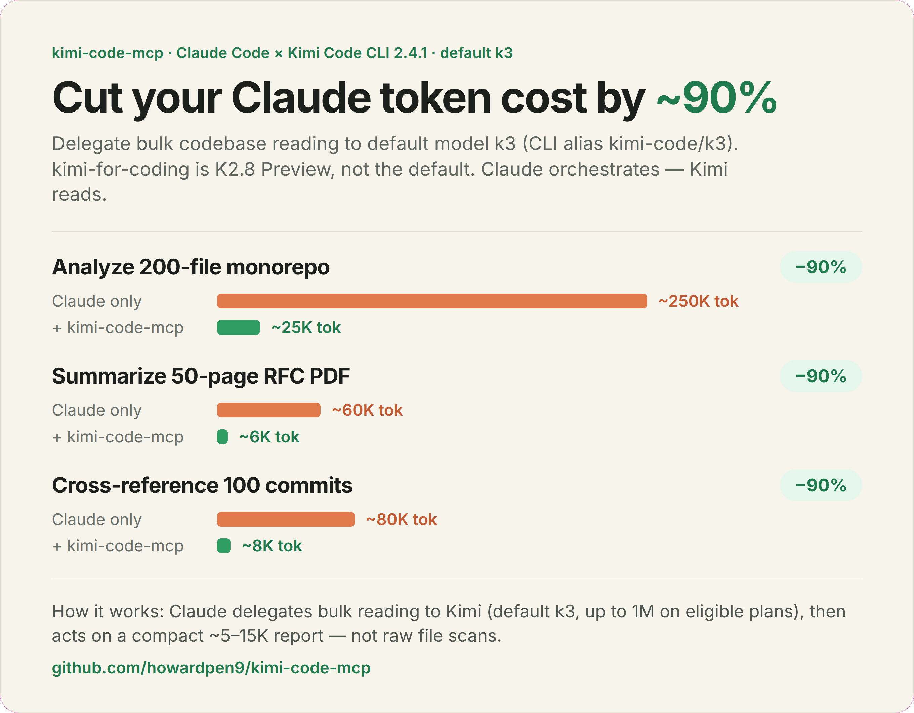
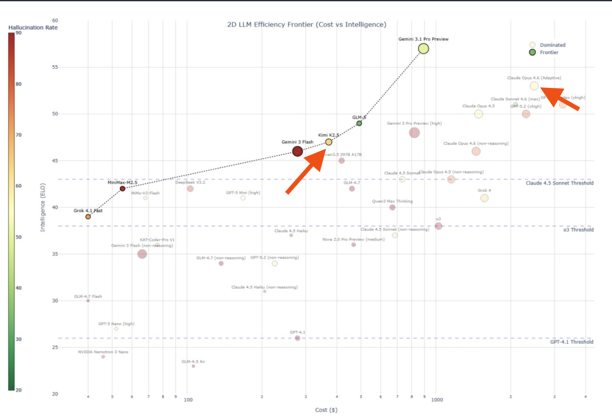

# kimi-code-mcp

**[English](README.md)** | 中文

---

<div align="center">
  
  <br />
  <sub>示意估算。這個 ~90% 是 <b>Claude 端</b> 在分析密集任務上的 token 減少 —— <b>不是</b>總成本歸零:Kimi 自己的<a href="https://www.kimi.com/code/en">訂閱費</a>照算。monorepo 那列對應下方實際舉例,PDF/commits 兩列為粗略示意。圖上預設是 <code>k3</code>（CLI 2.4.1）；<code>kimi-for-coding</code> 是 K2.8 Preview。</sub>
</div>

---

MCP 伺服器，將 [Kimi Code](https://www.kimi.com/code)（預設模型 `k3`，CLI 別名 `kimi-code/k3`）與 [Claude Code](https://code.claude.com/docs/en/mcp) 串接——Claude 當指揮家，Kimi 負責大量閱讀。

<div align="center">
  
  <br />
  <sub>Kimi Code 位於效率前沿——接近 Claude 的智能水準，成本僅 1/10。 <a href="https://www.kimi.com/code">kimi.com/code</a></sub>
</div>

> [!TIP]
> **別再花 Claude 的錢讀檔了。** Kimi Code 以極低成本提供前沿級程式碼智能（見上圖）。把批量程式碼掃描交給 Kimi，讓 Claude 專注推理、決策、精準改碼。一次 `kimi_analyze` 呼叫可以取代 50+ 次檔案讀取。上方圖表的 ~90% 是 Claude 端示意，分析密集型任務常見約 60-80%（見 [Token 經濟學](#token-經濟學)）。

## 什麼是 Kimi Code？

[**Kimi Code**](https://www.kimi.com/code/en) 是 Moonshot AI 的程式碼代理（終端機、IDE，以及 [Kimi Code CLI](https://www.kimi.com/code/docs/en/kimi-code-cli/guides/getting-started.html)）。CLI 是 TypeScript 套件 `@moonshot-ai/kimi-code`。公開文件目前列到 CLI **2.4.1**（2026-10-30）。它會讀寫程式碼、跑 shell、搜尋檔案、抓網頁。

下表的模型 id 來自 [Kimi Code 模型頁](https://www.kimi.com/code/docs/en/kimi-code/models.html)，別名前綴來自 CLI 2.4.1（managed provider 為 `kimi-code/<id>`）。上下文視方案而定（「最多」）。

| 模型 ID | CLI 別名 | 是什麼 | 上下文 |
|---------|----------|--------|--------|
| `k3` | `kimi-code/k3` | K3。**本 MCP 的預設。** | 最多 1,048,576 |
| `k3-256k` | `kimi-code/k3-256k` | K3 的 256K 視窗 | 262,144 |
| `k3.1-pro` | `kimi-code/k3.1-pro` | K3.1 Pro（3T 級，只能開 thinking） | 最多 1,048,576 |
| `k3.1-pro-highspeed` | `kimi-code/k3.1-pro-highspeed` | 同模型、更快，額度約 2 倍 | 最多 1,048,576 |
| `kimi-for-coding` | `kimi-code/kimi-for-coding` | K2.8 Preview | 最多 1,048,576 |
| `kimi-for-coding-highspeed` | `kimi-code/kimi-for-coding-highspeed` | K2.7 Code Highspeed | 262,144 |

本伺服器只改寫下面這張別名表，其餘字串原樣轉發：

| 你傳入 | API `model` | CLI `-m` |
|--------|-------------|----------|
| `k3`、`kimi-code/k3`、`kimi-k3` | `k3` | `kimi-code/k3` |
| `kimi-for-coding`、`kimi-code/kimi-for-coding`、`k2.7` | `kimi-for-coding` | `kimi-code/kimi-for-coding` |
| 其他（`k3-256k`、`k3.1-pro`、`kimi-code/k3.1-pro`…） | 原字串 | 同一個原字串 |

`k2.7` 是舊捷徑，仍會送出 `kimi-for-coding`（現在是 K2.8 Preview），不是 `kimi-for-coding-highspeed`。API 要裸 id，CLI 要 `kimi-code/<id>`。不在表內的 id，同一個 `model` 參數無法同時滿足兩邊。登入後用 `kimi provider list` 或 `/model` 確認；重新登入可能清掉自訂別名。

> [!WARNING]
> **需要 Kimi Code 會員。** API 工具（`kimi_query`、`kimi_verify`）要 **API key**。讀 codebase 的工具（`kimi_analyze`、`kimi_resume`）要 **CLI 在 `~/.local/bin/kimi`，並且 `kimi login`**。方案與額度見 [kimi.com/code](https://www.kimi.com/code/en)。

## 快速開始

```bash
# 1. 安裝目前的 Kimi Code CLI（macOS / Linux）並登入。
#    code.kimi.com/install.sh 會轉到已封存的 Python kimi-cli，不要用。
curl -fsSL https://code.kimi.com/kimi-code/install.sh | bash
kimi login

# Node.js >= 22.19.0 的替代：
# npm install -g @moonshot-ai/kimi-code

# 本伺服器只執行 ~/.local/bin/kimi。安裝程式把執行檔放在 ~/.kimi-code/bin。
mkdir -p "$HOME/.local/bin"
ln -sfn "$HOME/.kimi-code/bin/kimi" "$HOME/.local/bin/kimi"

# 2. 安裝這個 MCP（Node.js >= 18）
npm install -g kimi-mcp-server
```

> [!WARNING]
> 2026-11-02 查過，npm 上只有 `kimi-mcp-server@0.3.0`。Git `main` 是 0.5.0，尚未發布，所以 `npm install -g` 還不會預設 `k3`，也不會讀 `~/.kimi-code/config.toml`。要這頁描述的行為，在 0.5.0 發布前請從原始碼建置。

Windows（PowerShell）：`irm https://code.kimi.com/kimi-code/install.ps1 | iex`。這個 repo 的 runner 仍寫死 POSIX 路徑 `~/.local/bin/kimi`，請把安裝好的 `kimi` 連到那裡。

專案範圍：把 `.mcp.json` commit 在 repo 根目錄。使用者範圍存在 `~/.claude.json`，不是 `~/.claude/mcp.json`：

```bash
claude mcp add --scope user --transport stdio kimi-code -- npx -y kimi-mcp-server
```

專案 `.mcp.json`：

```json
{
  "mcpServers": {
    "kimi-code": {
      "command": "npx",
      "args": ["-y", "kimi-mcp-server"]
    }
  }
}
```

或從原始碼構建：

```bash
git clone https://github.com/howardpen9/kimi-code-mcp.git
cd kimi-code-mcp && npm install && npm run build
```

```json
{
  "mcpServers": {
    "kimi-code": {
      "command": "node",
      "args": ["/你的路徑/kimi-code-mcp/dist/index.js"]
    }
  }
}
```

在 Claude Code 中執行 `/mcp` 驗證，應該看到 `kimi-code` 和 8 個工具。

MCP 預設使用 `k3`，CLI 呼叫會傳入 `-m kimi-code/k3`。
可透過工具的 `model` 參數或 `KIMICODE_MODEL` / `KIMI_MODEL` 覆寫（參數優先）。
CLI 2.4.1 在有設預設時，`kimi provider list` 會印出 `Default model: …`，那個值可以跟 MCP 不同。在 CLI 裡用 `/model` 切換。

> [!TIP]
> **常見用途其實不需要 CLI。** `kimi_query` 和 `kimi_verify` 直接呼叫 Kimi Code API，不需要安裝 CLI，也不需要 `kimi login`。設好 `$KIMICODE_API_KEY` 即可（見 [Kimi Code API 設定](#kimi-code-api-設定)）。只有 `kimi_analyze` 和 `kimi_resume` 會啟動 CLI。完整對照見 [兩種後端：API vs CLI](#兩種後端api-vs-cli)。

## 兩種後端：API vs CLI

伺服器有兩種方式連到 Kimi，**每個工具會用最適合它的那一種**。知道哪個工具用哪種,就知道你需要設定什麼。

| 後端 | 怎麼連 Kimi | 需要什麼 | 看得到你的 codebase 嗎? |
|------|------------|---------|------------------------|
| **直連 API** | HTTPS 打 `api.kimi.com/coding/v1`（或 `KIMI_BASE_URL`） | API key（`$KIMICODE_API_KEY`，或 `~/.kimi/config.toml` / `~/.kimi-code/config.toml` 裡的 `api_key`） | ❌ 不行 — 由你把 context 貼進去 |
| **本機 CLI** | 執行 `~/.local/bin/kimi` | 該路徑有執行檔 **且** 完成 `kimi login` | ✅ 可以 — 直接從磁碟讀檔 |

| 工具 | 後端 | 原因 |
|------|------|------|
| `kimi_query` | **API**(沒設 key 時才退回 CLI) | 無上下文問答 — 不需 codebase,API 最簡單且無 login 依賴 |
| `kimi_verify` | **API** | 你把程式碼/diff/論點直接貼進去,Kimi 以獨立第三方身分判斷 |
| `kimi_analyze` | **CLI** | 從磁碟讀 codebase。上下文跟模型視窗走，不是固定 256K |
| `kimi_resume` | **CLI** | 接續一個保有先前 codebase 上下文的 CLI session |
| `kimi_list_sessions`、`kimi_cache_*`、`kimi_status` | 本機 | 讀本機快取；session 清單只看舊版 `~/.kimi` |

> [!IMPORTANT]
> **多數使用者只需要 API key。** 如果你只是要第二意見/驗證(`kimi_query`、`kimi_verify`),設好 API key 就完成了 — 完全不用碰 CLI。只有當你想讓 Kimi 透過 `kimi_analyze` / `kimi_resume` 讀你的 codebase 時,才需要安裝 + `kimi login`。

隨時執行 **`kimi_status`** 看 API 是否設了 key，以及 `~/.local/bin/kimi` 的版本。CLI 認證探測只看 `~/.kimi`（見下方說明），所以現代登入成功仍可能顯示未認證。這不影響 API 工具。

## 給 Agent 的使用準則

如果你是 AI agent(Claude Code、subagent 等),決定何時呼叫這些工具:

- **提交前交叉檢查自己的工作 → `kimi_verify`。** 貼上實際的 diff/程式碼/論點,**外加周邊 context**(目標、限制、函式簽名)。Kimi 只看得到 `context` 字串 — 沒有 repo、沒有 session 歷史。Context 含糊 → 審查無用。
- **快速、與模型無關的程式問題 → `kimi_query`。** 不需 codebase,回傳另一個模型的觀點。
- **需要理解大型/陌生的 codebase → `kimi_analyze`**(帶 `work_dir`)。優先用這個,別自己讀 50 個檔案;它省下約 10× 的 Claude token。需要 CLI 已安裝並登入。
- **analyze 後想深入 → `kimi_resume`**（帶回傳的 `session_id`。上下文是該 session 的模型視窗，不是固定 256K）。
- **不知道 Kimi 為何失敗 → 先 `kimi_status`。** CLI 顯示「未認證」**不影響** `kimi_query`/`kimi_verify`（那兩個走 API）。現代 CLI 的 OAuth 在 `~/.kimi-code`，`kimi_status` 可能誤報未認證。
- **輸出保持精簡。** 工具預設是 `detail_level: normal`。只要概覽就傳 `summary`；需要程式碼片段才用 `detailed`。輸出越大，Claude token 越多。
- **小型/單檔工作別用 Kimi** — 10 個檔案以下,Claude 直接讀更快。

## Kimi Code API 設定

> [!NOTE]
> **Kimi Code 和 Kimi Platform（Moonshot）是分開的。** Coding plan 的 id（`k3`、`kimi-for-coding`）不是 Platform id（`kimi-k3`、`kimi-k3.1-pro`）。`kimi-k2-0905-preview` 已停用。Key 不互通。

CLI 登入和直連 API key 是兩件事。`kimi login` 不會給 `kimi_query` / `kimi_verify` 一把 key。

### 方式一：OAuth 登入（CLI 工具）

```bash
kimi login
```

這是 device-code 流程（跟 TUI 裡的 `/login` 同一套憑證）。CLI 把設定、session、OAuth 寫在 `~/.kimi-code/`（可用 `KIMI_CODE_HOME` 改目錄）。舊資料可能還在 `~/.kimi`。登入後，有設預設時 `kimi provider list` 會印出 `Default model:`，不一定是 `kimi-code/k3`。managed provider id 是 `managed:kimi-code`。

> [!NOTE]
> **`command not found: kimi`？** 目前的安裝程式把執行檔放在 `~/.kimi-code/bin/kimi`，並把該目錄加進 shell rc。開新 shell，或 `source` 它印出的 rc。本 MCP **不搜尋 `PATH`**，只執行 `~/.local/bin/kimi`：
> ```bash
> mkdir -p "$HOME/.local/bin"
> ln -sfn "$(command -v kimi)" "$HOME/.local/bin/kimi"
> ```
> 用安裝腳本或 `npm install -g @moonshot-ai/kimi-code` 之後都要做這一步。

### 方式二：API key（直連 API 工具）

在 [Kimi Code console](https://www.kimi.com/code/console) 建立 key。MCP 依序讀 `KIMICODE_API_KEY`、`KIMI_CODE_API_KEY`、`KIMI_API_KEY`。`KIMI_BASE_URL` 可改 endpoint（預設 `https://api.kimi.com/coding/v1`；海外 coding host 是 `https://api.kimi.ai/coding/v1`）。

```bash
# ~/.zshrc 或 ~/.bashrc — 必須是 Claude 啟動 MCP 時看得到的環境，不是只在互動 shell
export KIMICODE_API_KEY="sk-你的API密鑰"
# export KIMI_BASE_URL="https://api.kimi.ai/coding/v1"
```

CLI **不會**從環境變數讀 `KIMICODE_API_KEY`。CLI 請用 `kimi login`，或在 `~/.kimi-code/config.toml` 設 `api_key` / `api_key_env`。MCP **不讀** `api_key_env`。它解析 TOML 時會展開引號裡的 `${VAR}`。

設定檔順序：`$KIMI_SHARE_DIR/config.toml`（有設才看）、`~/.kimi/config.toml`、`~/.kimi-code/config.toml`。只用 `[providers.*]` 裡的 `api_key` 和 `base_url`。`default_model` 和 `[models.*]` 不會改 MCP 的模型。

若要把 key 放進檔案而不是環境變數，目前 CLI 的形狀是：

```toml
default_model = "kimi-code/k3"

[providers."managed:kimi-code"]
type = "kimi"
base_url = "https://api.kimi.com/coding/v1"
api_key = "sk-你的API密鑰"
```

不要蓋掉 `kimi login` 已經寫好的檔案。登入後 `api_key = ""` 加上 `oauth` 表是正常的，MCP 用不了那把空 key。API 工具請用 `KIMICODE_API_KEY`。

### Kimi Code vs Kimi Platform

| | Kimi Code（這個 MCP） | Kimi Platform |
|--|----------------------|---------------|
| Endpoint | `https://api.kimi.com/coding/v1`（海外 `https://api.kimi.ai/coding/v1`） | Platform host，不是 coding 路徑 |
| 模型 id | `k3`、`k3-256k`、`k3.1-pro`、`kimi-for-coding`… | `kimi-k3`、`kimi-k3.1-pro`… |
| Key | [Kimi Code console](https://www.kimi.com/code/console) | [platform.kimi.ai models](https://platform.kimi.ai/docs/models) |

## 你可以做什麼

直接告訴 Claude 你需要什麼，它會自動委派給 Kimi：

| 你的 Prompt | 實際發生什麼 |
|------------|------------|
| 「分析這個 codebase 的架構」 | Kimi 讀整棵樹（預設 `k3`），Claude 根據報告行動 |
| 「掃描安全漏洞，然後審閱 Kimi 的發現」 | Kimi 審計，Claude 交叉審查——AI 結對審查 |
| 「映射 auth 模組的所有依賴，然後規劃重構」 | Kimi 建構依賴圖，Claude 規劃修改 |
| 「審閱最近的改動，檢查回歸和邊界情況」 | Kimi 審閱完整上下文（不只是 diff），Claude 整合 |
| 「恢復上次的 Kimi session，繼續問 API 設計」 | `kimi_resume` 接續那個 CLI session |

## 為什麼需要這個？

Claude Code 很強大，但每次讀檔都消耗 token。很多工作——預審大型程式碼庫、跨檔案掃描、生成審計報告——屬於**確定性高的尾部任務**，不需要 Claude 的完整推理能力。

> [!IMPORTANT]
> **成本算術：** Claude 讀 50 個檔案理解架構 = 昂貴。Kimi 透過 `kimi_analyze` 讀 50 個檔案 = 走 Kimi 訂閱，不走 Claude token。Claude 再根據報告行動 = 最少 Claude token。**分析密集型任務的 Claude token 大約少 60-80%**（上方圖表的 ~90% 是示意）。

### 如何省 Token

```
                      ┌─────────────────────────────┐
                      │   你（開發者）                │
                      └──────────┬──────────────────┘
                                 │ prompt
                                 ▼
                      ┌─────────────────────────────┐
                      │   Claude Code（指揮家）       │
                      │   - 編排工作流                │
                      │   - 做決策                    │
                      │   - 精準編輯程式碼             │
                      └──────┬──────────────┬───────┘
                  精準        │              │  委派
                  編輯        │              │  批量閱讀
                  (token)    │              │  (Kimi 方案)
                             ▼              ▼
                      ┌──────────┐   ┌──────────────┐
                      │ 你的     │   │  Kimi Code   │
                      │ 程式碼庫 │   │  - 模型 k3   │
                      └──────────┘   │  - 通讀全部   │
                                     │  - 回傳報告   │
                                     └──────────────┘
```

1. **Claude** 收到你的任務 → 判斷需要理解 codebase
2. **Claude** 透過 MCP 呼叫 `kimi_analyze` → Kimi 讀程式碼庫（訂閱費用，不是 Claude token）
3. **Kimi** 回傳結構化分析
4. **Claude** 根據分析做精準的程式碼修改

**結果：Claude 只花 token 在決策和寫碼，不浪費在讀檔上。**

### 基於 Kimi Code 的雙向程式碼審計

預設模型是 `k3`（K3）。這就夠做 **AI 結對審查**：

1. **Kimi 預審** — 一次看整棵樹：安全問題、反模式、死代碼、架構問題
2. **Claude 交叉審查** — 審閱 Kimi 的發現，質疑可疑項目，補充自己的洞察
3. **雙重視角** — 不同模型捕捉不同問題。一個遺漏的，另一個能發現

## 用 Kimi 做程式碼審查

除了即時分析，你可以將 Kimi 作為工作流中的**專職 Reviewer**：

### PR 審查流程

```
┌──────────────┐   diff    ┌──────────────┐  結構化發現  ┌──────────────┐
│   你的 PR    │ ────────► │  Kimi Code   │ ──────────► │  Claude Code │
│  (改動)      │           │  (審查者)    │             │  (決策)      │
└──────────────┘           └──────────────┘              └──────────────┘
```

### 持續審計模式

| 時機 | 做什麼 | 為什麼 |
|------|--------|--------|
| 合併前 | Kimi 掃描 diff + 受影響的模組 | 及早發現回歸 |
| 每週 | 全 codebase 掃描 | 累積的技術債 |
| 發版前 | 安全導向的全面審計 | 安心發版 |

有 CLI session id 時，審查 session 可以用 `kimi_resume` **恢復**。上下文跟該 session 的模型視窗走。

## 功能

| 工具 | 說明 | 超時 |
|------|------|------|
| `kimi_analyze` | **CLI** — 深度程式碼分析（架構、審計、重構建議） | 10 分鐘 |
| `kimi_query` | **API** — 快速問答，不需要 codebase 上下文（沒設 key 時才走 CLI） | 2 分鐘 |
| `kimi_verify` | **API** — 獨立第三方驗證程式碼／diff／論點；不需 CLI，需自帶完整 context | 5 分鐘 |
| `kimi_list_sessions` | 列出舊版 `~/.kimi/sessions`（不是 `~/.kimi-code`） | 即時 |
| `kimi_resume` | **CLI** — 用 `-S <id>` 恢復 session | 10 分鐘 |
| `kimi_status` | API key 狀態，以及 `~/.local/bin/kimi` 與 `~/.kimi` 的版本/認證 | 即時 |
| `kimi_cache_status` | 檢視 session 快取統計與效能指標 | 即時 |
| `kimi_cache_invalidate` | 手動清除快取 session（指定目錄或全部） | 即時 |

### 輸出控制參數

`kimi_analyze` 和 `kimi_resume` 支援以下參數控制輸出大小：

| 參數 | 值 | 預設 | 效果 |
|------|---|------|------|
| `detail_level` | `summary` / `normal` / `detailed` | `normal` | 控制 Kimi 輸出的詳細程度 |
| `max_output_tokens` | 數字 | `15000` | 硬上限——超過時在乾淨的段落邊界截斷 |
| `include_thinking` | boolean | `false` | 包含 Kimi 的內部推理鏈（額外 10-30K tokens） |

`kimi_query` 也支援 `max_output_tokens` 和 `include_thinking`。

## Token 經濟學

> [!NOTE]
> 節省來自**壓縮比**，不是免費閱讀。Kimi 仍需訂閱費用，但關鍵價值是減少昂貴的 Claude Code token 消耗。

```
                    不用 kimi-code-mcp            用 kimi-code-mcp (normal)
                    ────────────────              ─────────────────────────
Raw source:         50 檔 × ~4K = 200K tokens    Kimi 讀取（訂閱費用）
Claude 讀取:        200K tokens                  5-15K token 報告
Claude token 成本:  $$$                          $
```

**`detail_level` 壓縮比：**

| 級別 | 壓縮比 | 輸出大小 | 等效原始碼量 | 適用場景 |
|------|--------|---------|-------------|---------|
| `summary` | 40-100x | ~2-5K tokens | ~8-20K 字符 / ~200-500 行代碼 | 快速了解、檔案清單 |
| `normal` | 15-40x | ~5-15K tokens | ~20-60K 字符 / ~500-1500 行代碼 | 架構審查、依賴分析 |
| `detailed` | 5-15x | ~15-40K tokens | ~60-160K 字符 / ~1500-4000 行代碼 | 含代碼片段的安全審計 |

**省 token 的場景：**
- 大型 codebase（50+ 檔案）— 架構理解、跨檔案掃描
- 安全審計、死代碼偵測、API 一致性檢查
- 重構前預審（先掃描 → 再改特定檔案）

**不如直接讓 Claude 讀的場景：**
- 小型 codebase（<10 檔案）— 直接讀更快
- 單檔案修改 — Claude 內建讀檔就夠
- 需要每行代碼 — `detailed` 輸出接近直讀成本

## 運作原理

```
┌──────────────┐  stdio/MCP   ┌──────────────┐  subprocess   ┌────────────────────┐
│  Claude Code │ ◄──────────► │ kimi-code-mcp│ ────────────► │ Kimi CLI           │
│  (指揮家)    │              │ (MCP 伺服器) │               │ (k3)               │
└──────────────┘              └──────────────┘               └────────────────────┘
```

### CLI 呼叫參考

MCP 執行 `~/.local/bin/kimi`，讀 `kimi --help`，再以非互動模式呼叫。
下面的 flags 對得上 [Kimi Code CLI 指令參考](https://www.kimi.com/code/docs/en/kimi-code-cli/reference/kimi-command.html)，公開版本到 **2.4.1**（2026-10-30）：

```bash
cd <path>
kimi -m kimi-code/k3 -p "<prompt>" --output-format stream-json
```

| Flag | 用途 |
|------|------|
| `-p` / `--prompt` | 執行一次 prompt，跳過互動式 shell |
| `-m <alias>` | 明確選擇模型（預設 `kimi-code/k3`） |
| `--output-format stream-json` | 輸出 JSONL assistant/tool 訊息 |
| 工作目錄（`cwd`） | 指定 subprocess 的 codebase 根目錄 |
| `-S <id>` | 用 session ID 恢復之前的 session |

舊版的 `--print`、`--final-message-only`、`--no-thinking` 僅在該 CLI 的 help
宣告支援時傳入。Kimi Code 2.x 不支援這些 flags 或 `--work-dir`；
`thinking=false` 因此僅在支援的舊版 CLI 生效。`--plan` 不可與 `-p` 合用。

若回報 `Stored token ... was rejected; re-login required`，執行 `kimi login`。
本機模型 catalog 檢查不能證明 OAuth 有效或剩餘額度。

重新登入後，`subscription-peer/kimi` 等自訂別名可能消失。
請用 `kimi provider list` 確認可用別名，更新明確指定的 `model`、
`KIMICODE_MODEL` 或 `KIMI_MODEL`。MCP 已預設使用官方 `kimi-code/k3`，
不依賴 helper 的自訂別名。

repo 裡的測試固定 **2.1.1** 的 JSONL 形狀（重新登入後，最小 K3 prompt 回了 `KIMI_OK`）。這次改文件沒有對 2.4.1 二進位重跑。可選 flag 仍看 `kimi --help`，所以 `--print`、`--final-message-only`、`--no-thinking` 只有 help 有寫才會送。

`kimi_status` 只在 `$KIMI_SHARE_DIR` 或 `~/.kimi/credentials/kimi-code.json`（或舊的 `~/.kimi/kimi.json`）找到 token 時，才把 CLI 標成已認證。CLI 2.x 的 OAuth 在 `~/.kimi-code/credentials/`（`KIMI_CODE_HOME`）。`kimi login` 成功仍可能在這裡顯示未認證。這不影響 `kimi_query` / `kimi_verify`。

`kimi_list_sessions` 讀 `$KIMI_SHARE_DIR/sessions` 或 `~/.kimi/sessions`（`metadata.json`）。現在的 session 在 `~/.kimi-code/sessions/<workDirKey>/<sessionId>/`，列不出來。`kimi_resume` 仍把 `-S <id>` 傳給 CLI，所以你已經從 CLI 拿到的 id 可以恢復。

> [!NOTE]
> **`kimi analyze` subcommand 不存在。** MCP tool 命名為 `kimi_analyze`，但底層 CLI 使用上述 flags。如需直接呼叫 Kimi（除錯或腳本用途），請使用以上語法。

## 進階配置

開發模式（自動重編譯）：

```json
{
  "mcpServers": {
    "kimi-code": {
      "command": "npx",
      "args": ["tsx", "/你的路徑/kimi-code-mcp/src/index.ts"]
    }
  }
}
```

## 專案結構

```
src/
├── index.ts           # MCP 伺服器設定、工具定義、API/CLI 路由
├── kimi-api.ts        # 直連 Kimi Code API 的 client（kimi_query / kimi_verify）
├── kimi-runner.ts     # 生成 Kimi CLI 子行程、解析輸出、超時處理
├── cache-manager.ts   # session 快取（預熱、重用、失效）
└── session-reader.ts  # 舊版 session 元資料（~/.kimi/sessions，不是 ~/.kimi-code）
```

## 貢獻

請參閱 [CONTRIBUTING.md](CONTRIBUTING.md)。

## 變更日誌

請參閱 [CHANGELOG.md](CHANGELOG.md)。

## 授權

MIT
